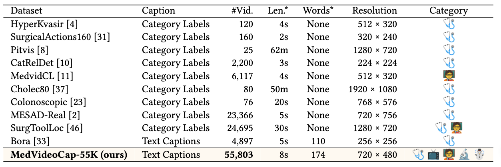

# Unlocking Medical Video Generation by Scaling Granularly-annotated Medical Videos


<p align="center">
[📃 <a href="https://arxiv.org/abs/2507.05675" target="_blank">Paper</a>] ｜ [🤗 <a href="https://huggingface.co/datasets/FreedomIntelligence/MedVideoCap-55K" target="_blank">Dataset</a>] ｜ [🤗 <a href="https://huggingface.co/FreedomIntelligence/MedGen-1.3B" target="_blank">Model (1.3B)</a>] ｜ [🤗 <a href="https://huggingface.co/FreedomIntelligence/MedGen-14B" target="_blank">Model (14B)</a>] ｜ [🚀 <a href="https://huggingface.co/blog/wangrongsheng/medvideocap-55k" target="_blank">Blog</a>]
</p>

## 🛎️ News

* **`Apr 18, 2026`:** We released our `training code`.
* **`Jul 8, 2025`:** We released our `paper`, `data` and `project`. Models are coming soon. Please stay tuned!

## ⚡ Introduction

Recent advances in video generation have shown remarkable progress in open-domain settings, yet medical video generation remains largely underexplored. Medical videos are critical for applications such as clinical training, education, and simulation, requiring not only high visual fidelity but also strict medical accuracy. However, current models often produce unrealistic or erroneous content when applied to medical prompts, largely due to the lack of large-scale, high-quality datasets tailored to the medical domain. To address this gap, we introduce **MedVideoCap-55K**, the first large-scale, diverse, and caption-rich dataset for medical video generation. It comprises over 55,000 curated clips spanning real-world medical scenarios, providing a strong foundation for training generalist medical video generation models. Built upon this dataset, we develop **MedGen**, which achieves leading performance among open-source models and rivals commercial systems across multiple benchmarks in both visual quality and medical accuracy.
We hope our dataset and model can serve as a valuable resource and help catalyze further research in medical video generation.

> [!NOTE]
> We open-sourced our models, data, and code here.

##### Release Progress

- [X] Paper: [arXiv](https://arxiv.org/abs/2507.05675)
- [X] Dataset: [HF (55k)](https://huggingface.co/datasets/FreedomIntelligence/MedVideoCap-55K)
- [X] Model Weights: [HF (1.3B)](https://huggingface.co/FreedomIntelligence/MedGen-1.3B)、[HF (14B)](https://huggingface.co/FreedomIntelligence/MedGen-14B)
- [X] Training Code
- [X] Evaluation Code
- [ ] Agent for Medical Video Generation

## 📚 Data

<div align="center">

</div>

You can [⬇️download our full MedVideoCap-55K](https://huggingface.co/datasets/FreedomIntelligence/MedVideoCap-55K) from HuggingFace. Our dataset has several features:

1. **Superior in quantity**. Our dataset comprising 55k medical videos. Supporting video generation across various medical scenarios, it includes medical education, medical imaging, clinical practice, and more. 
2. **Superior in visual quality**. Our dataset is strictly selected from the aspects of aesthetics, temporal consistency, motion smoothness, and clarity assessment. 
3. **Expressive in caption**. Previously proposed medical video datasets typically use category labels as captions. In contrast, our dataset provides expressive and coherent video descriptions with the help of MLLMs.

## 🚀 Training

```bash
# Install
pip install -r requirements.txt

# Train LoRA on 1.3B
bash scripts/train_lora_1.3B.sh

# Train full on 14B with DeepSpeed
bash scripts/train_full_14B.sh

# Generate single video
python inference.py --model_name "Wan-AI/Wan2.1-T2V-1.3B" \
  --checkpoint_dir "./models/train/wan_lora_1.3B" \
  --is_lora --prompt "your prompt"

# Batch generation
bash scripts/infer_batch.sh --metadata_path data/metadata.json
```

For more details, please refer to [quick start](QUICKSTART.md).

## 📈 Evaluation

Please refer to [evaluation](./evaluation).

## 🤩 Acknowledgement

Our works are inspired by the following works.

- [FastVideo](https://github.com/hao-ai-lab/FastVideo): a lightweight framework for accelerating large video diffusion models.
- [DiffSynth-Studio](https://github.com/modelscope/DiffSynth-Studio): an open-source Diffusion model engine developed.
- [VBench](https://github.com/Vchitect/VBench): a comprehensive benchmark suite for video generative models.
- [VideoScore](https://github.com/TIGER-AI-Lab/VideoScore): a automatic metrics to simulate fine-grained human feedback for video generation.

## 📖 Citation

```bibtex
@misc{wang2025medgenunlockingmedicalvideo,
      title={MedGen: Unlocking Medical Video Generation by Scaling Granularly-annotated Medical Videos}, 
      author={Rongsheng Wang and Junying Chen and Ke Ji and Zhenyang Cai and Shunian Chen and Yunjin Yang and Benyou Wang},
      year={2025},
      eprint={2507.05675},
      archivePrefix={arXiv},
      primaryClass={cs.CV},
      url={https://arxiv.org/abs/2507.05675}, 
}
```
